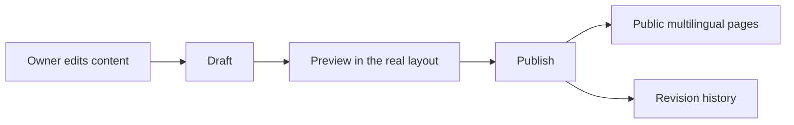

# Travessia do Sol

**A multilingual retreat-house website with a stay planner and a client-operated content system.**

[View the delivered site preview](https://preview.travessiadosol.com) · [All projects](https://github.com/alissonramosz/ai-product-portfolio)

| Role | Delivery | Focus |
| --- | --- | --- |
| Website and CMS developer | Client project; delivered version available at the preview link | Multilingual UX, interactive planning and content operations |

## Context

Travessia do Sol presents retreat houses and experiences to an international audience. Visitors need to understand the spaces, explore retreats and plan a possible stay. The owner needs to update changing information without editing the application code.

My work combines the public experience with the content-management workflow behind it: a responsive website in English, French and Portuguese, an interactive stay planner, and a focused CMS for retreats, testimonials and photographs.

## What I delivered

- **Multilingual website:** localized navigation, property and retreat information, galleries and enquiry entry points.
- **Stay planner:** dates, duration, guest configuration and an estimate summary that updates with the visitor's choices.
- **Retreat management:** multilingual retreat content, dates, imagery and structured lists managed by the owner.
- **Testimonials:** editing and publication with language fallback when a translation is missing.
- **Photo management:** uploads, a reusable media library, gallery ordering and replacement of images used across pages.
- **Editorial workflow:** drafts, preview, publication and revision history, with protection against conflicting edits.

## Product and engineering decisions

### Make the CMS fit the owner's actual work

The editor covers the content that changes regularly—retreats, testimonials and photos—rather than exposing every layout detail. Shared editing patterns keep those tasks consistent, while the public design remains controlled by the application.

### Editing and publication are different actions

A saved edit should not unexpectedly change the public site. Drafts and an authenticated preview let the owner inspect a change before publishing it. Version checks prevent one editing session from silently overwriting another.

### Media is part of the product workflow

The library tracks where an image is used, prevents removal while it is still referenced, and processes uploads for web delivery. Upload processing also removes image-location metadata. This makes replacing a photograph a manageable content task rather than a code change.

### The planner supports an enquiry

The estimate makes a potential stay easier to discuss. It is not presented as a payment checkout or a confirmed reservation.

## Delivery and access

The [preview deployment](https://preview.travessiadosol.com) shows the delivered application. At the time this case was prepared, the main `travessiadosol.com` website still served the previous version. The CMS requires owner access and is not a public demo.

## Technical implementation

| Layer | Technology | Responsibility |
| --- | --- | --- |
| Website and planner | TypeScript, Next.js, React | Localized pages and interactive stay estimates |
| CMS data | Supabase, PostgreSQL, SQL | Drafts, published content and revision history |
| Editor access | Supabase Auth and database access policies | Private editing and preview, separate from public reading |
| Media pipeline | Object storage, Sharp | Upload processing and reusable website images |
| Motion | GSAP, Lenis | Page interaction and scroll behavior |

Database work includes schema migrations, access policies and transactional publication. Version checks protect against concurrent edits; the preview reads drafts only within the authenticated editing workflow.

[Development workflow](https://github.com/alissonramosz/ai-product-portfolio#development-workflow)

This repository contains the public case study. Client content, media assets, administrative data and application source are not redistributed here.
